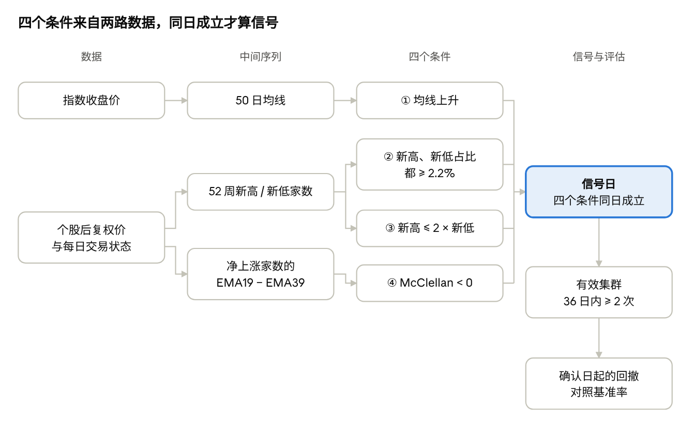
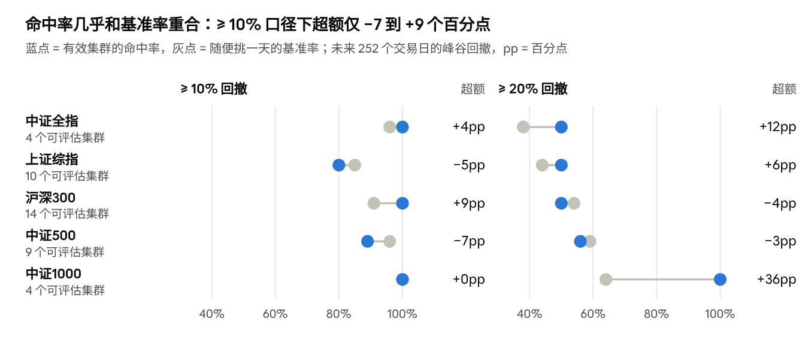

# 兴登堡预兆在 A 股的有效性检验

2026-10-13

## 摘要

**结论：兴登堡预兆在 A 股上没有表现出稳定的预警能力。** 它的「命中率」看起来很高，但同期随便挑一天的回撤概率（基准率）同样很高，两者之差在 −7 到 +9 个百分点之间，有正有负。

本文在中证全指、上证综指、沪深300、中证500、中证1000 上复现了这一指标，样本最长覆盖 2005 年至 2026 年 8 月。检验方法的关键是把研报只报告的命中率，和不看信号时的基准率放在一起比较。

此外，指标完全错过了 2015 年的大顶：市场从普涨直接切到普跌，「新高新低同时大量出现」这一条件一天都没成立。它更像是「抱团」这类结构性分化的价格投影，对齐涨齐跌的全面拥挤则看不见。

## 研究背景与问题

兴登堡预兆（Hindenburg Omen）是美股的一个顶部预警指标：指数仍在上涨，但市场内部同时有大量股票创新高和创新低，被视为上涨不健康、可能见顶的信号。

浙商证券《“兴登堡预兆”规避股指下跌的有效性如何？——筹码微观结构探秘系列（九）》（2026-06-26）把它搬到 A 股，并报告了很高的命中率。但研报只给出命中率，没有给出对照组。

本文要回答三个问题：

1. 按研报口径复现后，各指数的信号和命中率是什么样？
2. 命中率扣除基准率之后，还剩多少真正的预警能力？
3. 指标在什么样的市场里有用、在什么样的市场里失效？

## 指标定义与计算方法

四个条件同一天全部满足，才算一个信号日。条件①用指数本身，条件②③④用对应股票池里的个股。



个股只在当日有成交、上市满一年时计入统计，条件②③④都在这个股票池里数家数。

**条件① 趋势向上**：指数收盘价的 50 日均线高于 5 个交易日前的均线。

```math
MA_{50}(t) > MA_{50}(t-5)
```

**条件② 市场分化**：创 52 周新高的股票占比、创 52 周新低的股票占比，都不低于 2.2%。新高指当日后复权收盘价不低于过去 252 个交易日的最高收盘价。

```math
\frac{N_{high}(t)}{N(t)} \ge 2.2\% \quad \text{and} \quad \frac{N_{low}(t)}{N(t)} \ge 2.2\%
```

**条件③ 新高不占压倒优势**：新高家数不超过新低家数的 2 倍。

```math
N_{high}(t) \le 2 \times N_{low}(t)
```

**条件④ 宽度动量转弱**：McClellan 振荡器为负。它是每日净上涨家数的 19 日指数均线减去 39 日指数均线，平滑系数分别为 0.1 和 0.05。

```math
McClellan(t) = EMA_{19}(A_t - D_t) - EMA_{39}(A_t - D_t) < 0
```

实现上有三处细节会明显影响结果：

- **用收盘价算极值。** 用最高价算一年最高、再拿收盘价比较，新高会被严重低估。
- **用后复权价。** 不复权价在除权日断崖下跌，会被误判为新低，在高送转密集的 2014–2015 年尤其严重。
- **容忍停牌。** 252 日窗口内只要有 200 天有效价格就计算新高新低，否则停过牌的股票复牌后一年内都不计入。

**信号聚类。** 从第一个信号日起的 36 个交易日内，信号出现 ≥ 2 次即为「有效集群」，只出现 1 次为「单点」，单点不进入统计。

**回撤与定级。** 从集群确认日（第 2 次信号那天）起，计算未来 5、21、63、252 个交易日的峰谷最大回撤。研报从首日起算，但首日当天还不知道它会不会升级为有效集群，存在前视偏差。按 252 日回撤定级：≤ −20% 为较大回撤，≤ −10% 为中型回调，≤ −5% 为小幅回调。

## 数据与回测设置

个股使用全市场后复权日收盘价和每日交易状态，指数收盘价和成分股名单来自聚宽（JoinQuant），数据截至 2026-08-07。

五个指数各自用匹配的股票池算条件②③④，保证「趋势」和「宽度」说的是同一批股票：

| 指数 | 代码 | 股票池 | 回测起点 |
| --- | --- | --- | --- |
| 中证全指 | 000985.CSI | 全市场（剔除北交所） | 2011-08 |
| 上证综指 | 000001.SH | 仅沪市股票 | 2005-01 |
| 沪深300 | 000300.SH | 当日成分股 | 2005-04 |
| 中证500 | 000905.SH | 当日成分股 | 2007-01 |
| 中证1000 | 000852.SH | 当日成分股 | 2014-10 |

回测起点取指数在聚宽上有数据的第一天。每天计入统计的股票须同时满足：当日有成交、上市满 365 个自然日；不额外剔除 ST 股，因为 ST 股正是创新低的主力。以中证全指为例，每日股票池中位数为 3,459 只，范围 1,159 至 5,122 只。

## 检验方法：命中率必须对照基准率

一个信号有没有用，要看它把「下跌的概率」提高了多少，而不是看下跌概率本身有多高。本文用三个量来衡量：

- **命中率**：观察期已满的有效集群中，未来窗口内出现 ≥ 10%（或 ≥ 20%）峰谷回撤的比例。这是研报报告的数字。
- **基准率**：把样本里的每一天都当作信号日，用同样的口径算出的回撤概率，也就是「不看信号、随便挑一天」的结果。另外还算了只在条件①成立日抽样的版本，用来扣除趋势过滤本身的影响。
- **超额 = 命中率 − 基准率**。超额接近 0，说明信号没有提供额外信息。

这一步对 A 股尤其重要。A 股波动大，在 252 日窗口里出现 ≥ 10% 回撤的基准率高达 85%–100%。在这样的市场里，「信号后一年内都出现了回撤」几乎是必然的，命中率 90% 以上并不说明信号有预测力。

## 回测结果

五个指数的命中率都很高，但几乎都和基准率重合：≥ 10% 回撤口径下的超额仅 −7 到 +9 个百分点。各指数共有 53–134 个信号日、7–19 个有效集群。



<sub>数据：本项目回测，截至 2026-08-07；比例四舍五入到 1%。</sub>

≥ 20% 的更严格口径下，超额有正有负。最大的 +36 个百分点来自中证1000，只有 4 个可评估集群，不足以说明问题。

把窗口缩短也看不到优势。以中证全指为例，信号后各窗口内出现 ≥ 10% 回撤的概率：

| 未来窗口 | 集群数 | 命中率 | 基准率（全样本） | 基准率（趋势向上日） | 超额 |
| --- | --- | --- | --- | --- | --- |
| 5 日 | 7 | 0% | 1% | 1% | −1pp |
| 21 日 | 7 | 14% | 13% | 11% | +2pp |
| 63 日 | 6 | 33% | 43% | 38% | −10pp |
| 252 日 | 4 | 100% | 96% | 97% | +4pp |

一个季度内的命中率反而低于基准率 10 个百分点。只在趋势向上的日子里抽样，基准率也几乎不变，说明条件②③④没有带来额外信息。

## 案例：2015 年大顶为什么没有信号

2015 年 6 月是 A 股的大顶，但中证全指在 2015 年 6–9 月间条件②一天都没有成立，因此没有任何信号。原因是市场从「普涨」直接切到「普跌」，中间没有新高新低并存的阶段。

| 日期 | 中证全指 | 条件① | 新高占比 | 新低占比 |
| --- | --- | --- | --- | --- |
| 2015-06-12 | 7,984 | 成立 | 38.9% | 0.0% |
| 2015-06-19 | 6,943 | 成立 | 1.3% | 0.0% |
| 2015-06-29 | 6,044 | 成立 | 0.9% | 0.1% |
| 2015-07-03 | 5,391 | 不成立 | 0.1% | 0.8% |
| 2015-07-08 | 4,900 | 不成立 | 0.3% | 9.5% |

- **顶部（6 月中旬）**：约 30%–40% 的股票在创新高，几乎没有股票创新低。
- **下跌开始（6 月下旬）**：新高占比很快跌到 1% 以下，新低仍接近 0。
- **恐慌阶段（7 月 7–8 日）**：新低才跳到 5%–10%，但新高已不到 0.5%，条件①也在 7 月 3 日失效。

这是指标的设计盲区，不是计算错误。对照实验显示，部分公开复现之所以能在 2014-07、2015-06 附近标出信号，是因为用了不复权价且不过滤停牌，把除权跳空误当成了新低。

## 与拥挤度的关系

兴登堡预兆测的是「分化」，拥挤度测的是「扎堆」；两者的交集是抱团行情。

|  | 兴登堡预兆 | 拥挤度 |
| --- | --- | --- |
| 关注点 | 指数上涨时，市场内部是否新高新低并存 | 资金是否过度集中在少数股票、行业或因子 |
| 数据 | 只用价格：新高新低家数、涨跌家数 | 多用量和资金：成交额集中度、换手率、融资余额、股票间相关性 |
| 输出 | 0/1 信号 | 连续分数或历史分位数 |

**结构性拥挤可以被捕捉。** 资金扎堆少数龙头时，龙头创新高并拉动指数上行，被抽走资金的大量股票创新低，四个条件容易同时成立。沪深300 在 2020-12-22 至 2021-02-08 出现了 12 次信号的有效集群，正值机构抱团核心资产最极端的阶段；抱团瓦解后，沪深300 一年内回撤约 18%。中证全指 2021 年 7 月的集群之后，一年内回撤约 28%。

**全面拥挤看不见。** 2015 年是杠杆资金推动的全市场拥挤，股票齐涨齐跌、相关性极高，市场没有分化，条件②无法成立。这类风险要靠相关性、换手率、融资余额等拥挤度指标来识别。

## 结论与局限

**结论**

- 研报中「命中率 90% 以上」一类数字，主要反映的是 A 股本身回撤频繁，而不是信号的预测力。
- 扣除基准率后，≥ 10% 回撤口径下各指数的超额在 −7 到 +9 个百分点之间，≥ 20% 口径下在 −4 到 +36 个百分点之间，方向不一致。
- 短期没有优势：中证全指信号后 1 个月、1 个季度内的回撤概率，并不高于随便挑一天。
- 指标能对抱团式的结构性分化做出反应，但对 2015 年那样齐涨齐跌的全面拥挤完全失效。

**局限**

- 每个指数可评估的有效集群只有 4–14 个，命中率的置信区间很宽。中证1000 的 +36 个百分点只来自 4 个集群，偶然性很大。
- 2.2% 阈值是按几千只股票的市场设定的。沪深300 只有 300 只成分股，2.2% 不到 7 只，占比跳动大，规模指数的结果只适合和自身历史比较。
- 回撤是各自基准指数的回撤，各指数样本区间不同，命中率不能跨指数直接比较。
- 价格面板增量更新时不会自动加入新上市股票，长期不重建面板会让股票池逐渐缺少新股。

本报告仅供研究，不构成投资建议。

## 后续研究方向

既然单独使用没有稳定的预警能力，下一步是把它和拥挤度指标结合，看能否提高相对基准率的超额。

1. 从聚宽补充个股成交额和换手率数据，当前项目只有收盘价和交易状态。
2. 构建拥挤度指标，例如成交额前 5% 的股票占全市场成交额的比例，以及全市场换手率的历史分位数。
3. 检验「兴登堡集群 + 拥挤度高位」的组合，超额是否比单独使用更显著、更稳定。
4. 用相关性、融资余额等指标补上 2015 年这类全面拥挤的盲区。

复现代码见本仓库；在线[仪表盘](https://lshangro-png.github.io/hindenburg-omen/)和[参数实验室](https://lshangro-png.github.io/hindenburg-omen/lab.html)可以直接查看结果、调整参数。
